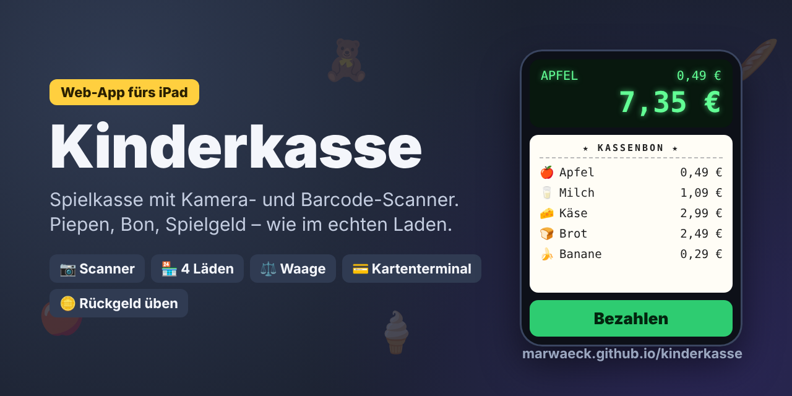

# 🛒 Kinderkasse

Eine Spielkasse für Kinder als Web-App, gemacht für das **iPad Pro 11"** (läuft aber in jedem modernen Browser).
Gegenstände oder Verpackungen über die Kamera halten – die Kasse piept, zeigt Artikel und Preis an und sagt den Preis an.

**Live:** https://marwaeck.github.io/kinderkasse/

## Funktionen

- **Scannen per Kamera** – Farberkennung für Spielsachen, die man vorher einmal „lernt“
- **Echte Barcodes** von Verpackungen – beim ersten Scan einmal benennen (Namensvorschlag über Open Food Facts), danach piept es sofort
- **Vier Läden** – Supermarkt, Bäckerei, Spielzeugladen, Eisdiele, jeweils mit eigenen Artikeln und Farben
- **Sonderangebote** (täglich wechselnd), **Rabattmarken** und **Gutscheine**
- **Waage** für Obst, Gemüse und Süßes mit Kilopreis
- **Bezahlen** mit Spielgeld-Münzen und -Scheinen (1 ct bis 100 €) oder am **Kartenterminal** mit PIN
- **Rückgeld selbst herausgeben** – zum Rechnen üben
- **Tagesabschluss** mit Kunden, Umsatz und meistverkauften Artikeln
- **Offline-fähig** und **Sicherung** der gelernten Artikel als Datei

## Bedienung

- Einstellungen: ⚙️ **gedrückt halten** (damit Kinder nicht aus Versehen etwas verstellen)
- Laden wechseln: oben links auf den Ladennamen tippen
- Im Querformat ist die Kamera-Seite links (iPad-Kamera); umstellbar in den Einstellungen

## Aufs iPad bringen

1. https://marwaeck.github.io/kinderkasse/ in Safari öffnen
2. Teilen → „Zum Home-Bildschirm“
3. App starten, „Kasse öffnen“, Kamera erlauben

Die Kamera funktioniert nur über `https://` (nicht als lokale Datei).

## Dateien

| Datei | Zweck |
|---|---|
| `index.html` | die komplette App (HTML, CSS, JavaScript) |
| `zbar.js` | Barcode-Erkennung ([@undecaf/zbar-wasm](https://github.com/undecaf/zbar-wasm) 0.11.0, LGPL-2.1+, siehe `ZBAR-LICENSE.txt`) |
| `sw.js` | Service Worker für den Offline-Betrieb |
| `manifest.webmanifest` | App-Infos für „Zum Home-Bildschirm“ |
| `apple-touch-icon.png` | App-Icon |
| `docs/social-preview.png` | Vorschaubild für GitHub |

Kein Build-Schritt nötig – der Ordner kann direkt auf einen statischen Webserver (z. B. GitHub Pages) hochgeladen werden.

## Daten

Gelernte Artikel, Einstellungen und Tagesstatistik liegen nur im Browser des Geräts (`localStorage`).
Einzige Verbindung nach außen: beim Benennen eines neuen Barcodes wird die Barcode-Nummer an openfoodfacts.org geschickt (abschaltbar).

## Ersteller und Lizenzen

Kinderkasse © 2026 Marcel.

Lizenzhinweise der verwendeten Bibliothek und Daten stehen in der App unter Einstellungen → Info.
